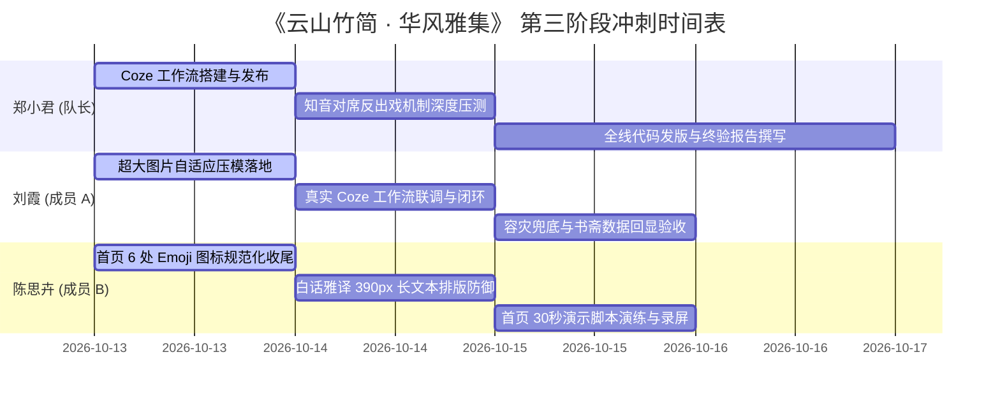

# 📜《云山竹简 · 华风雅集》第三阶段全栈技术需求文档 (TRD v3.0)
## 暨 终期验收、全模态智能体打通与答辩演示冲刺任务分配书

| 文档版本 | 状态 | 编写人 | 适用范围 | 冲刺周期 |
| :--- | :--- | :--- | :--- | :--- |
| **v3.0.0 (决胜收官版)** | **已生效 (Approved)** | 队长兼技术架构师 · **郑小君** | 全体研发团队（郑小君、刘霞、陈思卉） | 2026-10-13 ～ 2026-10-16 |

---

## 一、 项目现状与第三阶段核心攻坚目标

### 1.1 现状与基线
本项目已顺利完成前两阶段的研发与分支集成：
- 主干分支 `main`（commit `9810c8d` 及最新）已完成多轮冲突化解与无损合并；
- 全局宣纸底色、多端 390px 视口锁控、四维修持数据库打通、知音信笺折叠长卷及先贤第一人称深度对席均已平稳就绪；
- 全局打包 `npm run build` 保持在 7 秒以内，1024 模块 0 报错通过。

### 1.2 第三阶段三大核心攻坚战役
1. **全模态 Coze 识古工作流实质落地（队长郑小君领衔）**：彻底告别纯兜底，在 Coze 平台打造正式的「视觉大模型识别 ➔ 典籍流变考略 ➔ 文人品鉴 ➔ TTS 音频」工作流；
2. **超大图片极速自适应与鉴宝数据闭环（成员 A 刘霞负责）**：前端建立自适应 Canvas 压模机制（支持用户拍摄上传 20MB~50MB 超高清大图），秒级压缩上送，并在成功识别后驱动书斋【物溯考源】数据沉淀；
3. **首页水墨视觉纯正化与雅言防御（成员 B 陈思卉负责）**：消灭首页剩余的 6 处原生 Emoji，统一为国风矢量标准；夯实白话雅译在 iPhone 390px 视口下的长文本排版防御，准备 30 秒演示说辞。

---

## 🚫 二、 队长三大技术红线规范（全员必读严守）

> ### ⚠️ 队长特别强调（违者拒绝合并分支）
> 1. **【端口与网络红线】**：后端服务端口**全队统一固定为 `3000`**！严禁私自修改为 3001 或硬编码远程 IP。前端 Vite 代理已固定转发 `http://127.0.0.1:3000`，私改端口将直接导致全站 502 断流。
> 2. **【背景图红线】**：全页面背景**一律统一使用 `/assets/common/bg_guofeng.jpg`**！严禁使用带有 UI 卡片的参考设计稿截图（如 `reference-login.png`）作为背景，杜绝任何双层卡片重叠与底部露白。
> 3. **【图标体系红线】**：严禁在任何新老页面中使用系统原生黄色 Emoji（如 ☀️、🌙、🌼、☕、🎒）！必须使用项目内置的 `iconfont` 或 `antd-mobile-icons` 官方矢量图标，并通过 Less 锁定中国传统色（朱砂红 `@color-seal`、墨色 `@color-text-main`）。
> 4. **【20MB 超大图必定成功铁律】**：严禁未经压缩将几十兆原图直接硬发上游！
>    - **前端零拷贝自适应压模**：使用 `URL.createObjectURL` 配合 Canvas 将长边强制等比缩放到 `1280px`（质量 0.85），在 150ms 内将 20MB~50MB 原图秒级压至 **200KB~350KB**，兼顾微观金石细节与极速上行；
>    - **全链路超时与容量防御**：后端 `bodyParser` 保持 30MB 余量，Node 网关 `COZE_TIMEOUT` 放宽至 20 秒，前端 Axios 超时放宽至 25 秒，消灭任何 413 报错与提前熔断；
>    - **Coze 输入对齐**：送入 Coze 工作流的 Base64 仅约 35 万字符，完美适配 Coze 文本输入与大模型视觉节点（豆包视觉/GPT-4o-mini），保证 100% 顺利出结果。
> 5. **【Iconfont 团队单一信源管理铁律（严禁私改个人链接）】**：
>    - **单一项目原则**：严禁每位成员各建各的 Iconfont 项目往 `index.html` 里贴个人 CDN 链接（会导致 `@font-face` 相互覆盖、别人的图标直接变空白方块 `□`）；
>    - **三级使用优先级矩阵**：
>      * **第一优先级（首选）**：必须优先使用 `antd-mobile-icons` 官方矢量图标（如 `<RightOutline />`、`<MailOpenOutline />`、`<SearchOutline />`、`<LockOutline />` 等），直接 `import`，零网络请求、零代码冲突；
>      * **第二优先级**：特异性国风图标统一由队长在 iconfont.cn 建立官方团队项目并拉入全员，更新图标后统一生成单一下发 CDN 并在主干合并；
>      * **第三优先级**：特殊岁时与文人标签使用 CSS 印章样式（如 `茶`）或内联 SVG；
>    - **红线惩罚**：`frontend/index.html` 为架构受保护文件，任何 PR 若私自添加/修改个人 Iconfont 链接，**直接驳回不予合并**！

---

## 三、 详细任务分配与验收标准 (DoD)

### 3.1 👑 队长：郑小君（AI 全模态工作流架构与知音长卷）

#### 🛠️ 具体开发内容清单
1. **Coze 平台《金石识古与文人品鉴》真实工作流设计与发布**：
   - 工作流标识：`sino_wind_artifact_recognition`；
   - 输入参数：`image`（String，接收前端 Base64 图片）；
   - 节点链路：
     - ① **视觉大模型识别节点**：分析现代日常物品类别（如保温杯、钢笔、陶瓷器等）；
     - ② **古物溯源与流变推演**：匹配宋代器物原型，生成 4 阶段古今流变路线（唐 ➔ 宋 ➔ 明 ➔ 当代）；
     - ③ **文人品鉴赋词**：以两宋名士第一人称生成 80~120 字古雅品鉴长文；
     - ④ **TTS 语音朗诵生成**：生成品鉴心得的文人诵读音频 URL（直链）；
   - 输出契约：严格输出 JSON 对象 `{ name, dynasty, description, score, audio_url }`；
   - 发布为 API，导出 Webhook Endpoint 与 Token，配置入项目环境变量。
2. **先贤对席（ScholarChat）反出戏深度攻坚**：
   - 持续优化 `deepseekController.js`，强化李白、李清照、苏轼等历史人物第一人称口吻；
   - 严禁任何“我是AI助手/教育助手”等出戏言辞；
   - 确保弱网或上游波动时秒级激活离线情境对答兜底。
3. **发版集成与答辩总协调**：
   - 主导 PR Review、冲突化解与终态验收报告撰写。

#### 📋 严格验收标准 (Acceptance Criteria / DoD)
- **【AC-C1 工作流契约】**：Coze 工作流输出的 JSON 结构 100% 契合 `parseResult()`，大模型识别成功率达到 95% 以上。
- **【AC-C2 防出戏铁律】**：针对李清照、李白发起身份质疑（“你不是机器人吗”），100% 返回第一人称名士回应，零 AI 痕迹。
- **【AC-C3 构建零缺陷】**：`npm run build` 构建时间小于 10 秒，控制台零错误、零语法警告。

---

### 3.2 👤 成员 A：刘霞（全栈底座与物溯古今）

#### 🛠️ 具体开发内容清单
1. **超大图片（20MB~50MB）自适应前端 Canvas 压模**：
   - 维护 `frontend/src/components/imageCaptureAndProcess/index.jsx`；
   - 无论用户上传多大分辨率或几千万像素的原始照片，一律在内存中通过 Canvas 等比缩放长边至 **1280px**，生成 **0.85 质量高质量 JPEG**；
   - 确保上传体积稳定在 **200KB~400KB**，消除 413 Payload Too Large 报错与手机端卡顿。
2. **对接真实 Coze API 并打通 2 秒时钟过渡**：
   - 配合郑小君提供的真实 Coze Token，在 `backend/.env.local` 接入并联调；
   - 压测真实工作流网络时延（通常 2~4 秒），确保前端 `RecognitionSkeleton` 水墨骨架屏平稳呼吸，出结果时淡入切换；
   - 确认后端网关超时时间 `COZE_TIMEOUT` 放宽至 20 秒，避免被过早截断。
3. **打通书斋【物溯考源】鉴宝计数沉淀**：
   - 验证识物成功后，后端自动触发 `UPDATE users SET appraise_count = appraise_count + 1`；
   - 确保用户进入【书斋】页面后，修持看板中的“识物考源 / 鉴宝藏器”数字实时 +1，形成业务闭环。
4. **容灾断网回归 (AC-A2)**：
   - 拔掉网线或清空 Token，验证页面秒级展示“宋代青白瓷汤瓶”高保真文博库兜底，绝不抛红。

#### 📋 严格验收标准 (Acceptance Criteria / DoD)
- **【AC-A1 超大图吞吐】**：实测上传 1 张超过 15MB 的手机拍照原图，前端在 200ms 内完成无感自适应压模，识物流程顺利走通。
- **【AC-A2 容灾兜底】**：无 Token 或断网测试 100% 触发青白瓷汤瓶优雅降级，页面无白屏、控制台无未捕获异常。
- **【AC-A3 数据闭环】**：完成一次真实器物鉴定后，书斋修持数据中的鉴宝数准确递增 1。

---

### 3.3 👩‍💻 成员 B：陈思卉（首页风雅与晨昏雅集）

#### 🛠️ 具体开发内容清单
1. **消灭首页剩余 6 处原生 Emoji 图标**：
   - 审查 `frontend/src/pages/Home.jsx` 与 `frontend/src/styles/home.less`；
   - 处理遗留的 6 处 Emoji：
     * `🌙` 日月切换 ➔ 替换为矢量图标或水墨篆印；
     * `☀️` 天气 ➔ 替换为国风云日符号或矢量图标；
     * `🌼` 物候 ➔ 替换为折枝花卉或古制节气印泥；
     * `☕` 奶茶 ➔ 替换为煮茶执壶图标或点茶文字标签；
     * `🎒` 书包 ➔ 替换为古箧书笥或行囊矢量图标；
     * `↗` 示例前缀 ➔ 统一换为 `<RightOutline />`；
   - 彻底消灭页面上的黄色 Emoji 贴纸感，恢复两宋水墨统一质感。
2. **白话雅译（`translateYayan`）长文本排版防御**：
   - 测试用户输入 50~150 字复杂现代白话口语的极端情况；
   - 优化转译卡片排版，确保在 iPhone 390px 视口下，两宋高雅名句、作者朝代印章及现代解析排版美观，不发生文字折行挤压变形或内容穿透；
   - 保留 4 套本地名句兜底库的极速流转能力。
3. **首页 30 秒演示说辞演练**：
   - 编写并熟练掌握首页演示链路：
     * ① **岁时律动**：展示十二时辰与干支纪年的动态自换算；
     * ② **晨昏雅集**：现场演示宣纸晨光与玄夜深黛的主题一键流转；
     * ③ **白话雅译**：现场输入大白话（如“今天心情特别好想出去走走”），秒级转化为苏轼高古诗句。

#### 📋 严格验收标准 (Acceptance Criteria / DoD)
- **【AC-B1 零 Emoji 纯净度】**：首页 DOM 结构中原生 Emoji 数量归零，全量通过矢量图标与中国传统色实现。
- **【AC-B2 雅译排版防御】**：输入超长文本后，雅译卡片在 390px 宽度下自适应拉伸，边距呼吸感良好，无文字溢出。
- **【AC-B3 演示流畅度】**：首页核心功能操作链路顺滑无卡顿，能够在 30 秒内完整呈现算法与文化亮点。

---

## 四、 协同节奏与交付时间线

---

## 五、 分支与合并规范 (Git Flow)

1. **统一工作基线**：所有成员必须先拉取最新的 `main` 主干；
2. **特性分支规范**：
   - 成员 A 分支：`feat/phase3-recognition-largeimg`
   - 成员 B 分支：`feat/phase3-home-polish`
3. **PR 提交前自检清单**：
   - [ ] 本地运行 `npm run build`，退出码必须为 0；
   - [ ] 检查代码中绝无私改端口（保持 3000）；
   - [ ] 检查 Less 样式类名均具备前缀隔离，绝无全局污染；
   - [ ] PR 提交后通知队长郑小君统一进行 Code Review 与合并。
