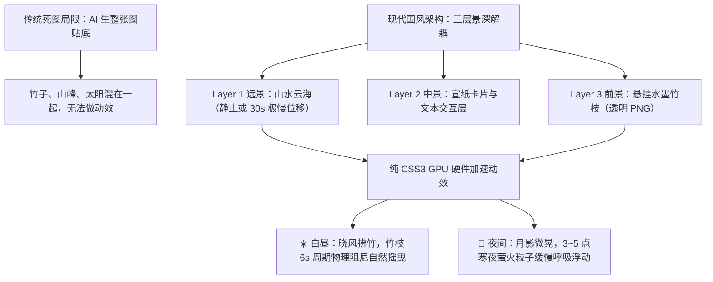

# 《云山竹简 · 华风雅集》设计稿全量深度体检与细节整改清单 (DESIGN_AUDIT.md)

> **审核时间**：2026-10-12  
> **审核人**：队长兼技术架构 C  
> **审核对象**：全套 7 张核心视觉稿（P1 雅集首页、P2 古诗展卷详情、P3 诗库检索列表、P4 知音信札列表、P5 迎请自定知己抽屉、P6 知音沉浸对话、P7 墨隐书斋主页）  
> **基准规范**：移动端工程落地标准 (390×844)、WCAG 2.1 AA 级无障碍易读性、宋韵文化考证与交互闭环

---

## 目录
1. [总评与核心肯定](#一-总评与核心肯定)
2. [图 1：【雅集 · 首页】深度细节剖析](#二-图-1雅集--首页深度细节剖析)
3. [图 2：【古诗词鉴赏 · 展卷详情】深度细节剖析](#三-图-2古诗词鉴赏--展卷详情深度细节剖析)
4. [图 3：【古诗词鉴赏 · 诗库检索】深度细节剖析](#四-图-3古诗词鉴赏--诗库检索深度细节剖析)
5. [图 4：【知音信札 · 消息列表】深度细节剖析](#五-图-4知音信札--消息列表深度细节剖析)
6. [图 5：【迎请故友 · 自定知己抽屉】深度细节剖析](#六-图-5迎请故友--自定知己抽屉深度细节剖析)
7. [图 6：【知音 · 沉浸对话】(李白对席论道) 深度细节剖析](#七-图-6知音--沉浸对话李白对席论道深度细节剖析)
8. [图 7：【墨隐书斋 · 个人中心】深度细节剖析](#八-图-7墨隐书斋--个人中心深度细节剖析)
9. [全套设计稿 4 大系统性通病剖析](#九-全套设计稿-4-大系统性通病剖析)
10. [夜间模式 (月下墨境 · 月黑风高) 落地标准与全页面对照表](#十-夜间模式-月下墨境--月黑风高-落地标准与全页面对照表)
11. [队友快速修改行动清单 (Checklist)](#十一-队友快速修改行动清单-checklist)
12. [动态国风动效架构规范（白昼摇竹 · 暗夜流光）](#十二-动态国风动效架构规范白昼摇竹--暗夜流光)

---

## 一、 总评与核心肯定

队友完成的这 7 张设计稿**宋韵美学功底极其扎实，视觉表现力拔群**：
- 暖宣纸肌理细腻温润，两端深木轴厚重逼真，沉浸感强烈；
- 卡片回纹描金角标、朱砂印章、飞白书法字体选择极具传统文人雅趣；
- 业务架构完整覆盖了“白话雅译、时令天象、识物鉴赏、诗词诵读、先贤信札、自定知己、沉浸对话、书斋收藏”全闭环。

**但站在移动端真实触控、代码工程实现、以及评委挑剔的评审视角下，全套稿件存在不少“只顾好看、忽略交互与规范”的微观硬伤**。为确保产品真正具备商业级与大赛答辩级水准，以下逐图进行像素级挑刺，并附带针对性修改方案。

---

## 二、 图 1：【雅集 · 首页】深度细节剖析

### 一、 交互与逻辑硬伤（最关键问题）
1. **【古今时令】完全像静态海报，零交互感**：
   - “杭州”、“2026年10月12日”、“未时 · 日昳”全部平铺直叙，没有任何可点击的线索（如 `⌄` 下拉标或 `[🧭 漫游]` 按钮）；
   - 用户一眼看过去会以为这只是写死的死文字或自动天气预报，根本不知道可以点进去换城市、换时辰、学古代叫法！
   - **整改**：在“杭州”后加一个小下拉箭头 `杭州 ⌄`；在“未时”后加 `未时 ⌄`；在卡片右上角加小微标 `[ 🧭 漫游 ]`。
2. **【白话雅译】输入框“不像输入框”，交互状态混乱**：
   - “今天心情特别好...” 这个卡片像一张静态展示牌，而不像一个能把键盘弹起来打字的输入控件；
   - 缺少占位提示文案（Placeholder），如：“输入你的日常大白话（如：今天心情真好）……”；
   - **按钮逻辑缺陷**：下面的【译为雅言】和【摘录入卷】并排摆放。用户还没输入或翻译呢，【摘录入卷】居然亮着可点击！未输入或未生成雅言前，【摘录入卷】必须置灰不可点击。
3. **【古今识物】左边是操作，右边是假例子，逻辑撕裂**：
   - 左侧是真实的拍照上传按钮；
   - 右侧写着“拍奶茶 ➔ 酪饮/酥签”、“拍书包 ➔ 箧笥/书笈”，这本质上是功能教程或静态 Demo 举例，但它做成了一排列表，用户用手指去点它没有任何反馈；
   - 这种“左边是真功能、右边是死文字举例”的设计会让用户感到困惑：我到底是在用功能，还是在看说明书？右侧青花瓷花瓶还挤占了大量空间。
4. **【古诗词赏析】空洞无物，“图大字少”**：
   - 这个卡片只写了一句《定风波·莫听穿林打叶声》和“深度赏析概览”，连一句核心诗句都没有展示出来！
   - 右侧的花枝、毛笔、砚台插画占了整整一半面积，信息密度极低。用户来这里是想读诗、赏雅趣的，看到的却是一个空荡荡的广告条。
   - **整改**：缩减右侧大插画，把《定风波》最经典的“一蓑烟雨任平生，也无风雨也无晴”两句诗印在卡片上。

### 二、 视觉与层级问题（过度装饰与视觉干扰）
5. **背景山水与前景卡片“打架”，背景太花**：
   - 全屏背景是一张极其繁复的大山水画（有远山、树木、楼阁、飞鸟、红日、舟楫）；
   - 在手机长屏上滑动时，山水的树枝和飞鸟会不断从卡片边缘切碎冒出来，视觉极度杂乱，严重干扰文字阅读；
   - **整改**：卡片背后应该有一层 85%~90% 不透明度的暖宣纸蒙层遮罩，只在页面最顶端和最底部微透山水意境，中间卡片区域必须干干净净！
6. **“框中有框、轴中有轴”，空间严重浪费**：
   - 最上面的“白话雅译”套了一个巨大木轴卷轴，两端两个大木轴头各占了 15px 宽度；
   - 下面的 3 个卡片又各套了一个回纹金边卡片，甚至卡片内部又套虚线框；
   - 横向空间被各种边框、木轴头吃掉了将近 20%，导致核心文字只能缩在很窄的中间区域。
7. **缺乏“第一视觉焦点”（四个卡片一样重）**：
   - 4 个模块的高度差不多、视觉装饰元素差不多重；用户打开页面时眼睛不知道往哪看，没有一个模块在视觉上担任“主角”。

### 三、 移动端工程与设计规范硬伤
8. **底栏【知音】的图标极其违和 ⚠️**：
   - 看底栏第二个图标：画的居然是一个古代木板推车 / 两轮货车！
   - 我们现在的【知音】是“千古知己对话 / 微信消息信札”，用一个推车/拉货的图标完全八竿子打不着！
   - **整改**：必须换成**古信札 / 飞鸽 / 抱琴**图标！
9. **缺失手机状态栏与底部安全区（真机直接被遮挡）**：
   - 顶部没有给手机状态栏（时间 9:41、电量、Wi-Fi、灵动岛/刘海屏）留出 44px 安全距离，标题直接顶在最上边缘；
   - 底部 TabBar 没有留出 iPhone 底部手势横条（Home Indicator）的 20~34px 安全高度，真机上底栏文字会被系统手势横条挡住一半。
10. **缺失【夜间模式 / 日月切换】入口**：
    - 顶部既无设置入口，也无昼夜切换控件，导致极具亮点的“月下墨境”无法主动演示。建议在顶部右上角“读千年风雅”旁增加一个精致的【☀️ 日 / 🌙 月】方印切换开关。

---

## 三、 图 2：【古诗词鉴赏 · 展卷详情】深度细节剖析

### 一、 交互与逻辑硬伤
1. **左上角完全缺失返回上一级键 `<`（致命死胡同）**：
   - 用户从首页或诗库列表点进该详情页后，**全屏找不到任何返回箭头的常规入口**；
   - 只能被迫去点击下方杂乱按钮中的“返回雅集”，严重破坏移动端左上角返回的操作直觉与手势返回习惯。
2. **四个操作按钮语义重叠、并列拥挤且位置逻辑混乱**：
   - 横排平铺了【🎴 摘录入卷】【↻ 重研墨宝】【📖 诗境赏析】【← 返回雅集】四个按钮；
   - **最荒谬的逻辑矛盾**：下方面板已经明明白白展开了“诗境赏析”，为什么上面还要并列一个【诗境赏析】按钮？点击它到底是要折叠、要刷新、还是要弹窗？
   - 移动端 390px 宽度下横排 4 个按钮，在小屏机型（如 iPhone SE / 迷你屏）上必然发生文字换行或右侧截断溢出。
3. **赏析面板折叠箭头方向与实际状态完全相反**：
   - 展开面板标题标为“诗境赏析 ∨”，带着向下箭头 `∨`；
   - 在移动端交互规范中，向下箭头通常代表“点击展开”，而当前内容已经是完整展开呈现的！已展开状态箭头应向上 `∧`。
4. **诗卷正文篇幅过短，撑不起“展卷鉴赏”场景**：
   - 偌大的宣纸长卷，里面只写了《水调歌头》开头的短短两句：“明月几时有？把酒问青天。不知天上宫阙，今夕是何年。”
   - 下半阙全无踪影，既没有全词向下平滑滚动的提示线索，也缺乏字句注释高亮交互。

### 二、 视觉与层级问题
5. **右下角实心水墨插画硬切正文，造成阅读撕裂**：
   - 下方赏析面板右下角放了一块实心不透明的山石松柏插画，导致正文段落被硬生生切掉一个直角；
   - 正文每行字长短不一，视线在折行时断裂感严重。应将插画调整为 15% 透明度的底层淡雅水印，正文采用通栏排版保障阅读流畅度。
6. **木轴边框挤占横向阅读视线**：
   - 左右两根深色卷轴端头占据了过多横向空间，文字被压缩在很窄的中部纵向区域。

### 三、 移动端工程与文化文案
7. **操作栏功能重构建议**：
   - 顶部左上角加回标准的 `<` 返回图标；
   - 移除多余的【返回雅集】按钮和重复的【诗境赏析】按钮；
   - 底部操作栏精简为三大核心操作：
     - 【🎴 摘录入卷】（主操作朱砂印章色）
     - 【↻ 换一首 / 重研墨宝】（次操作淡雅墨色）
     - 【🔊 听琴品韵】（音频朗诵与古琴配乐）

---

## 四、 图 3：【古诗词鉴赏 · 诗库检索】深度细节剖析

### 一、 交互与逻辑硬伤
1. **列表项缺少“名句摘要 (Snippet)”（信息密度过低）**：
   - 每一个诗词卡片只展示了标题（如《水调歌头·明月几时有》）和作者朝代（苏轼 · 宋代），**没有半句名篇正文预览**；
   - 用户查找诗词往往依赖标志性名句识别（如“但愿人长久，千里共婵娟”）。缺乏名句摘要让整个列表显得干瘪死板。
   - **整改**：在作者下方增加一行浅灰签名句：“人有悲欢离合，月有阴晴圆缺，此事古难全。”
2. **缺失分类与筛选标签栏 (Filter Chips)**：
   - 搜索框下方直接衔接列表项，没有分类维度；
   - 如果用户没有明确的搜索词，页面缺乏探索引导。应在搜索框下方增加横向滑动的宣纸小药丸标签：`[全部] [唐诗] [宋词] [写月] [旷达] [山水] [羁旅] [送别]`。
3. **搜索框缺少交互状态与辅助功能**：
   - 搜索框内部没有一键清除文本的 `✕` 按钮；
   - 未设计空输入态下的“历史搜寻墨痕（搜索历史）”与“大家都在品读（热搜词）”。
4. **底部近 40% 屏幕大面积留白浪费**：
   - 当前列表仅展示了 4 项，底部留出大面积空白山水，既没有分页加载指示器，也没有风雅的触底提示（如“已阅至卷尾 · 墨迹暂竭”）。

### 二、 视觉与规范硬伤
5. **“双重金边回纹嵌套”导致视觉负荷过重**：
   - 顶部搜索框自身套了一个金边回纹卡片，外层列表又套了一个巨大的金边大框，整体层级过度嵌套，视觉显得笨重不透气。
   - **整改**：搜索框使用轻量化宣纸微凹槽（凹陷内阴影）设计，去掉厚重的外层金框。
6. **右侧跳转箭头 `>` 视觉侵略感过强**：
   - 金黄色大箭头在每一行末端极为抢眼，破坏了水墨画面的素雅平衡，应弱化为精致的淡墨色细箭头。

---

## 五、 图 4：【知音信札 · 消息列表】深度细节剖析

### 一、 交互与逻辑硬伤
1. **顶部诗人头像横滑圈缺少“横滑截断暗示”**：
   - 顶部横排的 5 个圆形头像（李白、苏轼、李清照、杜甫、迎请新友）恰好严丝合缝填满一行屏幕宽度；
   - 用户会误以为系统总共就只有这 5 个人，根本不知道可以向右滑动探索更多先贤；
   - **整改**：让第 5 个头像露出 60%~70%，利用视觉边缘截断暗示，促使用户本能产生向右横滑的手势动作。
2. **消息时间与未读状态逻辑不统一**：
   - 杜甫信札显示“3 条未读”，卡片右侧却没有标注最新一条信札的接收时间；
   - 李清照的时间标为现代口语“昨日”，而李白的时间标为古雅时辰“辰时”；
   - **整改**：全站时间格式必须统一，均采用古今对照或统一步调的古典时辰（如“辰时一刻”、“昨日酉时”）。
3. **“迎请新友”核心功能入口层级被埋没**：
   - 自定义诗人（迎请故友）是极其高光的特色功能，但入口却缩在横滑头像圈的最右侧；
   - 建议在顶部导航栏右侧常驻一个精美的【+ 迎请】或【拜帖】朱砂小按钮。

### 二、 视觉与层级问题
4. **群聊头像“三脸拼盘”辨识度极差**：
   - 【竹林雅集 · 先贤群】的群头像是把三个文人半身像硬塞进一个小圆圈里，在 40×40 尺寸下人脸模糊成一团墨迹；
   - **整改**：采用“水墨幽篁竹林底图 + 描金‘雅’字印章”作为群聊专属国风头像，既大气又不会糊。
5. **李白头像左下角“华”字红印标寓意不明**：
   - 只有李白头像挂了一个红底“华”字徽标，其他诗人均无；
   - 用户无法识别该图标的含义（是“华风认证”？是“官方预设”？还是“置顶会话”？）。应改为明确的“置顶”微印或直接移除。

### 三、 文化考据与规范硬伤
6. **诗人名号后缀规范严重脱节**：
   - 李白标注为：`李白 · 诗仙`
   - 苏轼标注为：`苏轼 · 东坡居士`
   - 李清照标注为：`李清照 · 易安居士`
   - 杜甫标注为：`杜甫 · 诗圣`
   - **但最后一行用户自定的辛弃疾，只写了干瘪的三个字 `辛弃疾`，完全没有称号！**
   - **整改**：自定义诗人必须统一规范，补齐为：`辛弃疾 · 稼轩居士` 或 `辛弃疾 · 豪放宗师`。
7. **底栏【知音】图标依然是两轮手推车！🛒 ⚠️（致命必须改）**

---

## 六、 图 5：【迎请故友 · 自定知己抽屉】深度细节剖析

### 一、 交互与逻辑硬伤
1. **现代手机系统分享图标 `➦` 穿越出戏（最严重文化事故）⚠️**：
   - 在“知己朋友圈”这一行右侧，赫然画着一个标准的 Android/iOS 三点连线系统分享图标！
   - 用户在沉浸式设定千古名士时，突然看到一个手机微信朋友圈分享按钮，出戏感极强；
   - **整改**：彻底删除现代分享图标，替换为古雅的“知交谱”或金石印章图标。
2. **移动端键盘弹起遮挡核心按钮 (Keyboard Occlusion)**：
   - 抽屉包含“名号、朝代、生平纪略、生平羁绊、性格底色”等多栏表单，全卡片纵向高度超过 750px；
   - 当用户在真机上点击输入框时，软键盘弹起占据 300px 高度，底部的【✨ AI 一键考释赋魂】和【结为知己】两个核心操作将被完全顶出屏幕外，无法提交！
   - **整改**：设计稿必须明确内部表单为平滑滚动容器，且底部操作栏悬浮常驻吸底。
3. **缺失“诗人立绘头像选择 / 生成”入口**：
   - 表单设定了大量背景信息，却完全没有允许用户指定诗人头像的入口；
   - 迎请成功后，该诗人在会话列表中展示什么头像？
   - **整改**：在顶部“诗人名号”旁边增加一个圆形头像槽位：默认根据 AI 考释自动生成水墨头像，同时支持用户点击自选预设水墨立绘图库。
4. **朝代下拉选择器缺少展开态设计**：
   - “所属朝代：宋 ∨”目前仅有闭合静态，缺失点击后的古风 Picker 弹层设计。

### 二、 视觉与易读性硬伤
5. **“深色黑松树底图压住正文黑字”，严重违背易读性规范**：
   - 生涯纪略文本卡片内部铺了一张黑白水墨山水，右侧的深色松树针叶正好压在“报国之志终身不渝”正文字符下方；
   - 黑字印在黑树上，文字严重无法辨识，WCAG 对比度严重不达标；
   - **整改**：卡片内部彻底移除高对比度深色松树插图，改用纯净的暖宣纸微黄底色。
6. **文案现代感过重**：
   - “知己朋友圈”文案略带现代网络社区轻浮感，建议调整为更契合古典文人交往的**“生平文契 / 知交名录”**（记录如辛弃疾与陈亮之鹅湖之会、辛弃疾与朱熹之莫逆交）。

---

## 七、 图 6：【知音 · 沉浸对话】(李白对席论道) 深度细节剖析

### 一、 交互与逻辑硬伤
1. **巨幅立绘与 4 个推荐话题卡片缺失“动态折叠/收起机制”**：
   - 李白对月饮酒巨幅立绘 + “嗨阁下”问候语 + 4 个推荐话题卡片，占据了屏幕纵向 60% 以上空间（超 450px）；
   - 留给实际聊天消息气泡的区域仅剩屏幕底部的 150px（最多容纳 1 问 1 答）；
   - 当用户与李白持续对话时，这 4 个话题卡片和巨幅立绘如何处理？是跟随聊天内容上滑移出屏幕，还是折叠为顶部微型挂件？设计稿完全未定义多轮对话状态。
2. **消息时间戳与发送者身份标记不对称**：
   - 李白的气泡右下角标有时间 `09:41`，用户气泡完全没有时间戳；
   - 李白气泡左侧有圆形精致头像，而右侧用户气泡完全没有用户头像，用户在视觉上像一个“隐形幽灵”；
   - **整改**：用户气泡右侧增加用户专属古风头像（云山居士头像），并在两端气泡下方统一对齐古典时辰时间戳。
3. **底部输入栏缺失多模态与典故锦囊入口**：
   - 底部仅有单行输入框、麦克风和“畅论”按钮；
   - 用户无法发送图片（无法配合“古今识物”让李白鉴宝），也无法快捷引用自己在书斋摘录的诗笺或白话雅言；
   - **整改**：输入框左侧增加一个古典的 `+` 或【锦囊】印章按钮，支持唤起“赠酒、呈览诗笺、识物请教”多模态操作面板。

### 二、 视觉与排版问题
4. **左上角返回键 `<` 与浓墨竹叶发生穿模冲突**：
   - 页面左上角的返回箭头直接压在前景茂密竹叶的黑色枝条上，辨识度与触控视觉极差。
5. **现代电容麦克风图标与宋韵完全割裂**：
   - 语音输入图标使用了现代录音室/播客电容麦克风造型 `🎙️`，与右侧朱砂篆刻方印“畅论”并排摆放，违和感强烈；
   - **整改**：换用 Alibaba Iconfont 中的水墨声波纹或编钟/号角古风图标。
6. **背景岩石穿透聊天气泡**：
   - 李白白色宣纸气泡后方直接叠在深色山石背景上，半透明宣纸若在真机上渲染，背景乱石会直接破坏气泡字迹阅读。

### 三、 文化考据与文案沉浸感（最致命人设硬伤）
7. **李白开场白竟然是“嗨，阁下！”（诗仙人设严重破功崩塌）⚠️**：
   - 画面中李白豪迈举杯对月，然而一开口对话框里竟然是现代网络打招呼用语：“嗨，阁下！”！
   - 这在文史考核、古风爱好者与专家评审面前属于严重的低级人设事故；
   - **整改**：必须重写为盛唐文风：“哈哈！适逢雅客至，且共饮金樽！”或“有朋自远方来，且随吾尽兴！阁下今日有何所思？”

### 四、 工程与安全区
8. **顶部贴顶无 44px 状态栏空间**；
9. **底部输入栏贴地（0 安全区）**：距离屏幕底边不到 10px，全面屏手势黑条将直接横穿在输入框下半部分。

---

## 八、 图 7：【墨隐书斋 · 个人中心】深度细节剖析

### 一、 交互与逻辑硬伤
1. **严重功能缺失：全页面没有“整装离席 / 退出登录”入口！⚠️**：
   - 作为一个完整的 App 个人中心 / 设置主页，从上到下完全找不到退出登录、切换账号的出口；
   - 用户一旦登录即无法退出，在移动端交互设计与应用上架规范中属于功能不完整重大缺陷；
   - **整改**：在“书斋清规”卡片下方增加一个独立的幽雅退出按钮：【整装离席 · 退出登录】。
2. **缺失夜间模式 / 墨色外观设置项**：
   - “书斋清规”中列出了账号、隐私、通知、帮助，却唯独缺失了本产品最具亮点的“墨色雅意（昼夜模式切换 / 字号调节）”；
   - **整改**：在清规列表中第二项增加“墨色雅意（晓色晨宣 / 月下墨境切换）”。
3. **数据统计卡片零点击线索**：
   - “12 鉴宝藏器”、“36 论道问策”、“48 诗签摘录”、“8 自定知友”四列数据是平铺静态文本；
   - 没有轻微的 `>` 箭头或可触控态，用户不知道点击“48”可以直接跳进“我的诗笺”列表。

### 二、 视觉与层级问题
4. **顶部标题区“大杂烩”，视觉信息严重过载**：
   - 顶部不仅有“墨隐书斋”大字、华风印、对联副标题，背景同时塞入了：竹林、远山、红日、飞鸟、雕花窗棂、木桌、古籍书堆、青花瓷瓶梅花；
   - “墨隐书斋”四个字直接压在山腰和飞鸟上，视觉噪点多到眼花缭乱；
   - **整改**：大幅弱化背景山水对比度（Opacity 20%），移除多余的重叠小物件，让大标题居中享有足够留白。

### 三、 工程与图标规范硬伤
5. **“鉴物图谱”图标又是两轮手推车！🛒 ⚠️（荒谬复现）**：
   - “鉴物图谱”是古今器物考释记录（青铜器、瓷器、古玉等），图标竟然放了一个两轮小推车！
   - 结合底栏【知音】也是手推车，整个 App 出现了两处莫名其妙的手推车，设计稿呈现出严重的素材敷衍拼凑感；
   - **整改**：“鉴物图谱”换成**宝鼎 / 玉佩 / 铜镜**图标；底栏【知音】换成**古信札 / 飞鸽**图标。
6. **功能列表全套使用冰冷现代 Material/iOS 线条图标**：
   - 账号设置（圆头小人）、隐私安全（现代挂锁）、消息通知（现代小铃铛）、帮助反馈（现代圆圈问号）；
   - 都是冷冰冰的现代手机图标，与宋韵书斋氛围严重割裂；
   - **整改**：全部采用 Alibaba Iconfont 定制的古风线稿图标（如印谱、锁匙、云雀、卷轴）。
7. **缺失顶部 44px 状态栏与底部 34px 手势安全区**。

---

## 九、 全套设计稿 4 大系统性通病剖析

1. **手推车图标泛滥成灾 (The Handcart Phenomenon) ⚠️**：
   - P1、P4、P7 的底栏 Tab 2【知音】全部画成了手推车；
   - P7 书斋中的“鉴物图谱”也画成了手推车；
   - 必须全站强制使用 Alibaba Iconfont 项目 (`font_5104647` / `font_5241957`) 中的对应标准类名，彻底杜绝素材乱用。
2. **手机系统安全区全面阵亡 (0 Safe Area Insets)**：
   - 全套 7 张图，每一张顶部都贴着 0px 顶边（真机上 iPhone 灵动岛、9:41 时间、电池电量会直接盖在大标题上）；
   - 全套 7 张图，每一张底部都贴着 0px 底边（真机上手势黑条会直接横切在 TabBar 文字或输入框上）；
   - **规范**：所有设计稿画板必须标出：顶部安全区 `44px`、底部安全区 `34px`。
3. **背景水墨喧宾夺主，缺乏纸张蒙层 (High Visual Noise)**：
   - 7 张图的卡片后方都缺乏足够的宣纸蒙层遮挡，导致深色山峰、松树、飞鸟屡屡从正文背后穿透出来，严重影响文本阅读体验；
   - **规范**：内容卡片区域必须垫一层 88% 不透明度的纯净宣纸底板。
4. **宋韵文风偶发“现代穿帮”**：
   - P5 的现代三点连线分享图标 `➦`；
   - P6 李白的“嗨，阁下！”现代口语；
   - P6 的现代电容麦克风图标 `🎙️`；
   - 必须保持全场景古风文人语境的严肃性与沉浸感。

---

## 十、 夜间模式 (月下墨境 · 月黑风高) 落地标准与全页面对照表

### 1. 昼夜流转运行机制（自动感应 + 手动乾坤）
- **自动感应（天机流转）**：
  - 前端读取本地设备时间 `new Date().getHours()`；
  - **戌时至寅时（晚 19:00 至次日 06:00）**：系统自动点亮【月下墨境 · 月黑风高】；
  - **卯时至酉时（早 06:00 至晚 19:00）**：系统自动呈现【晓色晨宣 · 暖宣墨韵】。
- **手动切换（手挽乾坤）**：
  - 顶部右上角常驻【☀️ 日 / 🌙 月】太极印章开关，用户点击即可瞬时切换；
  - 个人中心【书斋清规】->【墨色雅意】支持三档持久化设置：`[自动感应古今时令 (跟随时间)]`、`[常驻晓色晨宣 (白昼)]`、`[常驻月下墨境 (夜间)]`。

### 2. 队友出图策略（无需画 14 张图！）
- 队友**仅需出一张【P1 雅集首页的夜间模式效果图】**作为核心视觉标杆；
- 其余 6 个页面由技术团队通过 CSS Variables / Less 样式 Token 映射表自动变色，极大地为设计队友减负！

### 3. 全局设计 Token 映射对照表

| 视觉元素 | 白昼模式（晓色晨宣） | 夜间模式（月下墨境 · 月黑风高） |
| :--- | :--- | :--- |
| **全屏底色** | `#F7F4EB` (暖宣纸微黄底) | **`#121518` (玄墨黛青底，如深山寒夜)** |
| **卡片材质** | `#FFFFFF` (纯白绢帛微透) | **`#1C2126` (深砚半透微光，带 1px 细冷金边)** |
| **天象主图** | 浅赭红日、闲云飞鸟 | **一轮冰魄明月高悬、水波倒影、冷冽夜气** |
| **主标题字** | `#2B2B2B` (浓墨黑) | **`#E2DDD5` (月白玉色，高对比高可读)** |
| **次要说明** | `#6B675B` (淡墨灰) | **`#8C867A` (银灰月影色)** |
| **边框线条** | `#C8A86B` (暖金回纹) | **`#6E5D3F` (冷古铜金，微带暗金哑光)** |
| **时令气象** | 晴 24°C · 未时日昳 | **晴冷 16°C · 亥时人定（夜深人定，一枕清梦）** |
| **朱砂印章** | `#8A2B2B` (鲜明红泥印) | **`#9E3333` (暗夜温润烛火红，带 1px 柔和微光)** |
| **激活高亮** | `#8A2B2B` (朱红指示条) | **`#C8A86B` (点金荧光指示条)** |

---

## 十一、 队友快速修改行动清单 (Checklist)

### 🎯 全站统一规范（优先级最高）
- [ ] 顶部增加 `44px` 状态栏安全高度（预留 9:41、灵动岛、电量空间）；
- [ ] 底部 TabBar 与操作栏增加 `34px` 底部安全区（避免全面屏手势黑条遮挡）；
- [ ] 卡片背后垫 `88%` 不透明度暖宣纸蒙层，彻底消除背景乱石飞鸟干扰；
- [ ] 彻底消灭全站所有“手推车”图标，统一替换为标准古风图标！

### 🎯 页面专项整改
- [ ] **P1 雅集首页**：
  - [ ] 底栏【知音】图标换为古信札/飞鸽；
  - [ ] 时令模块增加 `杭州 ⌄`、`未时 ⌄` 与 `[🧭 漫游]` 按钮；
  - [ ] 白话雅译输入框加灰色占位文案，未翻译前【摘录入卷】置灰；
  - [ ] 诗词卡片缩减插画，印上《定风波》核心名句；
  - [ ] 顶部右上角增加【☀️ / 🌙】昼夜切换开关。
- [ ] **P2 诗词展卷**：
  - [ ] 左上角补齐返回 `<` 箭头；
  - [ ] 诗卷正文补充至 4~6 句或增加滚动展示；
  - [ ] 移除冗余的【返回雅集】与重叠的【诗境赏析】按钮，精简为三大操作；
  - [ ] 展开面板的箭头改为向上 `∧`；
  - [ ] 右下角山石插画改为透明水印底纹，避免切断文字。
- [ ] **P3 诗库检索**：
  - [ ] 列表项补齐千古名句摘要；
  - [ ] 搜索框下方增加分类筛选标签 Chips；
  - [ ] 取消搜索框厚重金框，减少双重嵌套；
  - [ ] 底部增加风雅触底提示。
- [ ] **P4 知音信札**：
  - [ ] 辛弃疾补充后缀 `辛弃疾 · 稼轩居士`；
  - [ ] 顶部头像圈让第 5 个露出一半，制造横滑截断悬念；
  - [ ] 群聊头像换为水墨竹林底 + 烫金“雅”印；
  - [ ] 统一信札时间为古典时辰格式。
- [ ] **P5 自定知己**：
  - [ ] 坚决删除现代手机分享图标 `➦`；
  - [ ] 生涯纪略卡片移除黑色松树背景，避免压死黑字；
  - [ ] 增加诗人立绘头像选择/上传入口；
  - [ ] 明确定义弹起键盘时的容器滚动交互。
- [ ] **P6 沉浸对话**：
  - [ ] 修改李白开场白，严禁出现“嗨，阁下！”；
  - [ ] 清理左上角返回键遮挡的茂密竹叶；
  - [ ] 现代电容麦克风图标换为古风声韵图标；
  - [ ] 用户气泡右侧补齐头像与对称时间戳；
  - [ ] 定义推荐话题卡片在长对话时的折叠/上滑逻辑。
- [ ] **P7 墨隐书斋**：
  - [ ] 底部补齐【整装离席 · 退出登录】按钮；
  - [ ] 增加【墨色雅意】外观设置项；
  - [ ] “鉴物图谱”的手推车图标换为古鼎/玉佩；
  - [ ] 列表图标全面古风化，替换冰冷现代线条图标；
  - [ ] 弱化顶部大杂烩背景山水，留出标题呼吸感。
- [ ] **夜间模式与动态切图**：
  - [ ] 输出 **1 张【P1 雅集首页 · 月下墨境】效果图**（高悬寒月、玄墨黛青底、微光金边）；
  - [ ] 配合输出分层素材：① 纯净远景水墨底图（无竹子）；② 左上角水墨竹枝透明切片 `bamboo-foreground.png`。

---

## 十二、 动态国风动效架构规范（白昼摇竹 · 暗夜流光）

为了避免全屏 AI 背景图作为“静态死图”导致的生硬感，系统采用**【三层水墨景深分离 + CSS3 GPU 阻尼摇曳】**架构：



### 1. 动效实现参数（零第三方依赖，满帧 60fps）
- **左上角近景竹枝**：挂在屏幕 `top: 0; left: 0;`，设 `pointer-events: none`（绝对不挡用户点击），`transform-origin: top left`。
- **物理摆动关键帧**：
  ```css
  @keyframes bambooBreeze {
    0% { transform: rotate(0deg) skewX(0deg); }
    35% { transform: rotate(-2.8deg) skewX(-1.2deg); }
    70% { transform: rotate(1.2deg) skewX(0.8deg); }
    100% { transform: rotate(-1.5deg) skewX(-0.5deg); }
  }
  ```
- **夜间变色**：切换为夜间模式时，CSS 一行滤镜 `filter: brightness(0.4) contrast(1.3)` 自动将竹枝转为深墨月影，摆动周期放缓至 9s。

### 2. 设计队友素材配合方法（极简，免手绘）
1. **背景底图**：AI 提示词加入 `pure distance misty mountains, clean sky, no foreground trees`，生成干净无杂物的全屏底图；
2. **竹枝切片**：AI 单独生成一束白底水墨竹枝（`Chinese ink bamboo branch hanging from top-left, pure white background`）；
3. **去底透明化**：通过免费去底工具去掉白底，导出透明通道 PNG（`bamboo-foreground.png`，大小约 40KB）；
4. 技术团队在代码中组装层叠，一秒实现“清风徐来，修竹轻摇”的活水墨沉浸意境！

