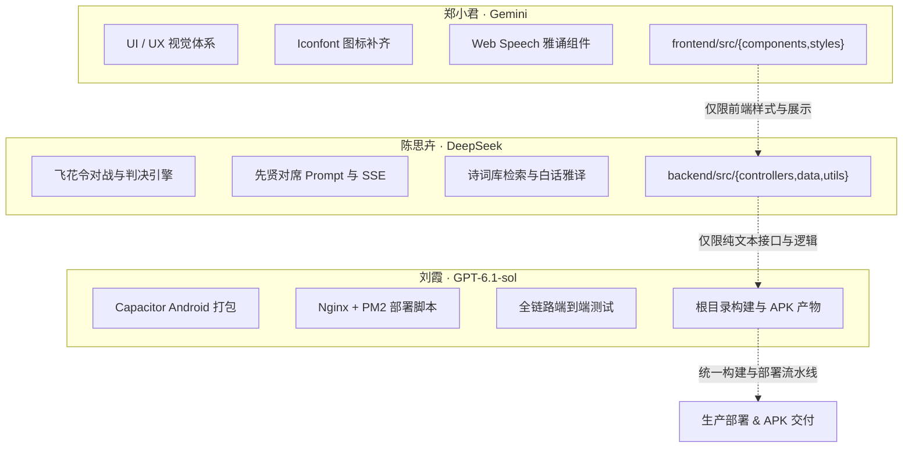

# 🚩 云山竹简·华风雅集 · 全链路闭环与上线决战任务书 (2026-10-15)

> **决战目标**：今日完成全站业务逻辑 100% 闭环，彻底打通识物溯古、先贤论道、飞花令竞技三大核心场景，完成生产服务器高可用部署（Nginx + PM2），并完成移动端 Android APK 打包交付。  
> **协作原则**：**职责物理隔离、接口先行、互不阻塞、互不踩踏、单兵闭环**。

---

## 一、 人员角色、模型特长与核心分工总览

| 成员 | 负责方向 | 分配模型 | 模型特质与扬长避短 | 核心工作区（严格物理隔离） |
| :--- | :--- | :--- | :--- | :--- |
| **郑小君** | UI/UX 视觉体系与全局 Iconfont 图标闭环 + 前端雅音吟诵 | **Gemini** | 多模态视觉理解卓越、CSS/LESS 审美极高、擅长国风组件排版。 | `frontend/src/components/` `frontend/src/assets/` `frontend/src/styles/` `frontend/index.html` |
| **陈思卉** | 核心古风文本业务闭环 + 飞花令/先贤论道/白话雅译算法 | **DeepSeek** | 纯文本与复杂逻辑推理极强，古典文学底蕴深厚，长文本与格律判断精准；**不能识别图片，完全专注纯文本**。 | `backend/src/controllers/deepseekController.js` `backend/src/controllers/feihuaController.js` `backend/src/controllers/poemController.js` `backend/src/utils/feihuaEngine.js` `backend/src/data/` |
| **刘霞** | 全链路工程构建、Android APK 打包 + 服务器高可用部署运维 | **GPT-6.1-sol** | 顶级系统架构、工程构建与脚本编写能力、移动端打包与 Linux/Nginx/Docker 运维专家。 | 项目根目录构建配置 `deploy/` `android/` / Capacitor 配置 `nginx/` 打包发布产物 |

---

## 二、 特别变动通报：Coze 语音节点变更与应对方案

> [!IMPORTANT]
> **关键变动说明**：
> 上游 Coze 智能工作流已**精简架构，去除原生语音合成（TTS）节点**，目前直接高效输出结构化纯文本物象考释（`name`、`dynasty`、`description`、`score`）。
> 
> **技术应对方案（零损失、更可靠）**：
> 1. **后端解耦**：后端网关保持健壮解析，当 `audio_url` 为空时，不报错、不阻塞，正常返回结构化数据。
> 2. **前端接管**：由**郑小君**升级前端 `recognitionResult/Index.jsx`，全面切换至浏览器原生成熟的 **Web Speech 雅言吟诵引擎**。配合国风水墨声波涟漪动效，实现毫秒级零延迟朗读，彻底摆脱外部音频加载失败或跨域问题，保障 100% 有声体验！

---

## 三、 详细任务拆解与交付物 (DoD)

### 🎨 1. 郑小君（UI/UX 视觉与 Iconfont 负责人 · Gemini 驱动）

#### 任务背景与核心要求
依托 Gemini 的多模态视觉感知与国风审美，负责全站界面的最终视觉收敛，彻底消灭破损图标、默认符号，优化 Coze 识物后的展示与原生语音播报体验。

#### 详细任务清单
1. **全局 Iconfont 阿里矢量图标库清洗与补齐**：
   - 梳理目前引用的外部图标库（`font_5104647_jepi4y0iy5.css` 与 `font_5241957_rgqdox4q9h.css`）。
   - 检查全站各功能页面，消灭一切形似 `[?]`、未定义方块或生硬的默认 emoji。
   - 重点补齐与规范：
     - **底部导航栏**：雅集（卷轴）、物溯（博古架/放大镜）、对席（羽扇/茶盏）、书斋（文房四宝/案台）。
     - **状态与操作图标**：白天/黑夜（日月同辉矢量 Glyph）、印章朱砂、收藏金石、分享、重新拍摄、音律声波。
2. **物溯古今（Recognition）前端雅音吟诵器交互与动效重构**：
   - 适配 Coze 无语音现状：在 `frontend/src/components/recognitionResult/Index.jsx` 中，将原有的音频加载转变为高雅的「**【先贤雅诵】**」控制器。
   - 点击播放时，调用精调后的 Web Speech API 朗诵器（推荐中文字符朗读语调），并展示水墨振荡声波（CSS 脉冲波纹）。
   - 强化得分展示：将品位鉴值（如 90 分）以书法朱批印章或古法星级方式高雅呈现。
3. **全站移动端水墨视口排版走查**：
   - 检查 375px（iPhone SE）、390px（iPhone 14/15/16）、412px（主流 Android）下的视口自适应，确保无横向滚动条。
   - 确保 `InkSpreadZone` 水墨晕染和朱砂印章层级（`z-index`）合理，不遮挡按钮与文字交互。

- **交付物 (DoD)**：
  - [x] 全站所有页面 Iconfont 统一国风风格，0 破损图标。
  - [x] 识物结果页「先贤雅诵」Web Speech 交互流畅，水墨声波灵动。
  - [x] 移动端多视口完美自适应，样式无溢出。

---

### 📜 2. 陈思卉（古风业务逻辑与文学算法负责人 · DeepSeek 驱动）

#### 任务背景与核心要求
发挥 DeepSeek 顶级中文文学底蕴与严密逻辑推理能力，专注纯文本业务，构建高可玩性、高文学水准的闭环系统，完全不涉及图片处理。

#### 详细任务清单
1. **飞花令（Feihua）完整竞技算法与业务闭环**：
   - **核心文件**：`backend/src/utils/feihuaEngine.js`、`backend/src/controllers/feihuaController.js`。
   - **令字扩充**：建立包含「花、月、春、风、夜、酒、云、雨、山、水」等 10 大核心经典令字的权威诗词库。
   - **智能判定逻辑**：
     - 诗句存在性与出处判定（精准匹配对应唐诗宋词名篇）。
     - 平水韵/现代拼音韵脚合规性校验。
     - 历史已出诗句去重（严禁双方重复报同一句诗）。
     - 超时倒计时与胜负裁决逻辑（胜局积分累加到书斋看板）。
2. **先贤对话（ScholarChat）人设与流式交互终极调优**：
   - **核心文件**：`backend/src/controllers/deepseekController.js`。
   - 完善李白（豪放豁达、千金散尽）、苏轼（旷达通透、人间清欢）、李清照（凄清婉约、金石博古）、王阳明（知行合一、心外无物）等名士的 Prompt 体系。
   - 100% 坚守名士风骨，杜绝任何“我是人工智能语言助手”等现代出戏字眼。
   - 确保 `/api/deepseek/chat/stream` SSE 流式传输稳定，连接保持机制完善。
3. **白话雅译与诗词品鉴算法闭环**：
   - 完善 `/api/deepseek/yayan` 白话雅译双向互译质量（现代白话 ➔ 典雅古文，古诗词 ➔ 唯美意境解析）。
   - 完善 `poemController.js`：诗词检索、随机抽签、收藏夹同步逻辑，确保未登录访客与登录文士均有丝滑体验。

- **交付物 (DoD)**：
  - [x] 飞花令对句验证、去重判定与胜负结算逻辑 100% 跑通。
  - [x] 先贤对席第一人称文学浸润感极佳，SSE 流式极速响应。
  - [x] 诗词库检索与白话雅译稳定输出，无异常报错。

---

### 🚀 3. 刘霞（工程交付、APK 打包与云端部署负责人 · GPT-6.1-sol 驱动）

#### 任务背景与核心要求
依托 GPT-6.1-sol 超强的工程架构与全栈运维能力，负责全站打包、移动端 APK 生成、服务器部署与全链路端到端验收。

#### 详细任务清单
1. **移动端 Android APK 打包工程闭环**：
   - **技术选型**：Capacitor 或 Android WebView 原生外壳工程。
   - **工程配置**：
     - 应用包名：`com.sinowind.app`
     - 应用名称：`云山竹简·华风雅集`
     - 配置国风应用图标（App Icon）与启动屏（Splash Screen）。
     - 适配 Android 相机（`CAMERA`）与存储读写（`READ_MEDIA_IMAGES`）权限声明，确保拍照识物正常拉起系统相机。
   - **离线资源适配**：检查前端构建产物 `base` 相对路径配置，确保打包至 APK 后本地 `file://` 协议加载 0 白屏。
   - **打包输出**：编译输出可直接在 Android 真机安装体验的 `app-release.apk`（或 `app-debug.apk`），并提供一键打包脚本。
2. **生产服务器高可用部署配置 (Linux + Nginx + PM2)**：
   - **后端守护**：编写 `ecosystem.config.js`，通过 PM2 管理 Koa 服务（自动重启、负载、日志轮转）。
   - **Nginx 反向代理配置**：
     - 托管前端静态资源目录 `dist`。
     - 反向代理 `/api/` 路由至后端 3000 端口。
     - 关键配置：针对 SSE 流式对话开启 `proxy_buffering off;`，设置超时时间防止断流。
     - 开启 Gzip 压缩与静态资源缓存加速。
   - **一键部署脚本**：编写 `deploy.sh`（拉取最新代码 ➔ 依赖安装 ➔ 前端 build ➔ PM2 reload ➔ Nginx reload）。
3. **全链路端到端自动化联调与回归验收**：
   - 走查全站主流程：识物上传 ➔ 结果展现 ➔ 先贤雅诵 ➔ 先贤对席 ➔ 飞花令对战 ➔ 书斋收藏。
   - 校验网络断开或上游超时情况下的容灾兜底页面，确保系统永不白屏。

- **交付物 (DoD)**：
  - [x] 产出可在真机安装运行的 Android APK 文件。
  - [x] 交付生产部署脚本 `deploy.sh`、`ecosystem.config.js` 与 `nginx.conf` 范本。
  - [x] 全站各链路端到端通过验收。

---

## 四、 协同防冲突军规（三权分立，互不干扰）

1. **目录物理隔离，禁止跨区提代码**：
   - 郑小君专心修改前端样式与组件视觉，不碰后端控制器和数据库。
   - 陈思卉专心修改后端纯文本与文学算法逻辑，不碰前端页面和多模态图像接口。
   - 刘霞负责根目录配置、打包与部署工程，集成时合并各方模块。
2. **分支开发策略**：
   - 郑小君使用分支：`feat/zheng-ui-iconfont`
   - 陈思卉使用分支：`feat/chen-deepseek-logic`
   - 刘霞使用分支：`feat/liu-apk-deploy`
   - 联调完成后，由刘霞统一合并验收至 `main` 分支。
3. **接口调用规范**：
   - 前后端协议遵循已发布的 TRD 规范，若需临时增减字段，以文档中明确的 Mock 协议为准。

---

## 五、 今日作战时刻表

| 时间节点 | 任务里程碑 | 责任人 | 检查点 |
| :--- | :--- | :--- | :--- |
| **14:00 - 15:30** | 各单兵模块就位：Iconfont 梳理 / 飞花令算法加固 / Capacitor 工程搭建 | 全员 | 各成员在独立分支完成首版代码 |
| **15:30 - 17:00** | 核心业务闭环：Web Speech 雅诵联动 / 先贤论道与飞花令跑通 / APK 调试 | 全员 | 本地功能完整自测无报错 |
| **17:00 - 18:30** | 分支合并至 main，全链路本地联调，生成 Release APK 包 | 刘霞牵头，全员配合 | 产生可在真机安装的 APK |
| **18:30 - 20:00** | 生产服务器部署，Nginx 反代配置，线上正式环境全量回归 | 刘霞 + 郑小君 | 线上域名/公网 IP 访问正常，全站体验闭环 |

今日全体同心，必克全功！
