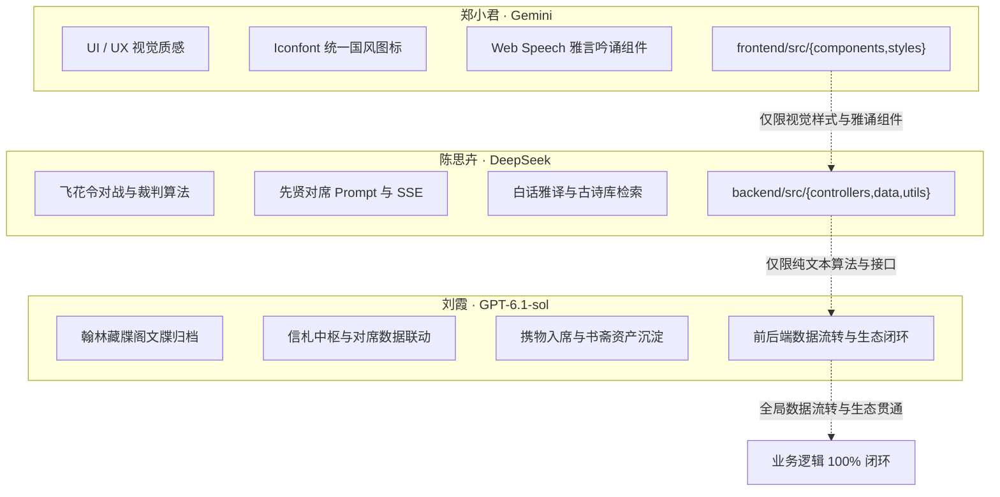

# 🚩 云山竹简·华风雅集 · 核心业务逻辑全面闭环任务书 (2026-10-15)

> **当前阶段核心目标**：将所有核心业务逻辑打通并完成 100% 闭环（彻底解决 Coze 语音变动、飞花令竞技闭环、先贤反出戏、藏牒阁与信札生态联动）。  
> **重要说明**：**「移动端 Android APK 打包」与「生产服务器最终部署上线」属于全系统闭环后的最终交付动作，本阶段暂不占用开发精力，留待各模块闭环后再统一执行**。  
> **协作原则**：**职责物理隔离、接口先行、互不阻塞、互不踩踏、单兵闭环**。

---

## 一、 人员角色、模型特长与核心分工总览

| 成员 | 负责方向 | 分配模型 | 模型特质与扬长避短 | 核心工作区（严格物理隔离） |
| :--- | :--- | :--- | :--- | :--- |
| **郑小君** | UI/UX 视觉质感 + 全局 Iconfont 图标闭环 + 前端雅音吟诵器 | **Gemini** | 多模态视觉理解卓越、CSS/LESS 审美极高、擅长国风组件排版。 | `frontend/src/components/` `frontend/src/assets/` `frontend/src/styles/` `frontend/index.html` |
| **陈思卉** | 核心纯文本业务算法 + 飞花令对战竞技 + 先贤论道与雅译 | **DeepSeek** | 纯文本与复杂推理极强，古典文学底蕴深厚，长文本与格律判断精准；**不能识别图片，完全专注纯文本**。 | `backend/src/controllers/deepseekController.js` `backend/src/controllers/feihuaController.js` `backend/src/controllers/poemController.js` `backend/src/utils/feihuaEngine.js` `backend/src/data/` |
| **刘霞** | 知音生态闭环 + 翰林藏牒阁功名系统 + 信札中枢与资产沉淀 | **GPT-6.1-sol** | 全栈系统架构、数据持久化与复杂业务状态流转专家，主攻全栈业务闭环联动。 | `backend/src/controllers/scholar*` `frontend/src/pages/MinePage.jsx` `frontend/src/pages/LetterList.jsx` `frontend/src/components/Scholar*` |

---

## 二、 特别变动通报：Coze 语音节点变更与应对方案

> [!IMPORTANT]
> **关键变动说明**：
> 上游 Coze 智能工作流已**精简架构，去除原生语音合成（TTS）节点**，目前直接高效输出结构化纯文本物象考释（`name`、`dynasty`、`description`、`score`）。
> 
> **技术应对方案（零损失、更可靠）**：
> 1. **后端解耦**：后端网关保持健壮解析，当 `audio_url` 为空时，不报错、不阻塞，正常返回结构化数据。
> 2. **前端接管**：由**郑小君**升级前端 `recognitionResult/Index.jsx`，全面切换至浏览器原生成熟的 **Web Speech 雅言吟诵引擎**。配合国风水墨声波涟漪动效，实现毫秒级零延迟朗读，彻底摆脱外部音频加载失败或跨域问题，保障 100% 有声体验！

---

## 三、 详细任务拆解与交付物 (DoD)

### 🎨 1. 郑小君（UI/UX 视觉与 Iconfont 负责人 · Gemini 驱动）

#### 任务背景与核心要求
依托 Gemini 的多模态视觉感知与国风审美，负责全站界面的最终视觉收敛，彻底消灭破损图标、默认符号，优化 Coze 识物后的展示与原生语音播报体验。

#### 详细任务清单
1. **全局 Iconfont 阿里矢量图标库清洗与补齐**：
   - 梳理目前引用的外部图标库（`font_5104647_jepi4y0iy5.css` 与 `font_5241957_rgqdox4q9h.css`）。
   - 检查全站各功能页面，消灭一切形似 `[?]`、未定义方块或生硬的默认 emoji。
   - 重点补齐与规范：
     - **底部导航栏**：雅集（卷轴）、物溯（博古架/放大镜）、对席（羽扇/茶盏）、书斋（文房四宝/案台）。
     - **状态与操作图标**：白天/黑夜（日月同辉矢量 Glyph）、印章朱砂、收藏金石、分享、重新拍摄、音律声波。
2. **物溯古今（Recognition）前端雅音吟诵器交互与动效重构**：
   - 适配 Coze 无语音现状：在 `frontend/src/components/recognitionResult/Index.jsx` 中，将原有的音频加载转变为高雅的「**【先贤雅诵】**」控制器。
   - 点击播放时，调用精调后的 Web Speech API 朗诵器（推荐中文字符朗读语调），并展示水墨振荡声波（CSS 脉冲波纹）。
   - 强化得分展示：将品位鉴值（如 90 分）以书法朱批印章或古法星级方式高雅呈现。
3. **全站移动端水墨视口排版走查**：
   - 检查 375px（iPhone SE）、390px（iPhone 14/15/16）、412px（主流 Android）下的视口自适应，确保无横向滚动条。
   - 确保 `InkSpreadZone` 水墨晕染和朱砂印章层级（`z-index`）合理，不遮挡按钮与文字交互。

- **交付物 (DoD)**：
  - [x] 全站所有页面 Iconfont 统一国风风格，0 破损图标。
  - [x] 识物结果页「先贤雅诵」Web Speech 交互流畅，水墨声波灵动。
  - [x] 移动端多视口完美自适应，样式无溢出。

---

### 📜 2. 陈思卉（古风业务逻辑与文学算法负责人 · DeepSeek 驱动）

#### 任务背景与核心要求
发挥 DeepSeek 顶级中文文学底蕴与严密逻辑推理能力，专注纯文本业务，构建高可玩性、高文学水准的闭环系统，完全不涉及图片处理。

#### 详细任务清单
1. **飞花令（Feihua）完整竞技算法与业务闭环**：
   - **核心文件**：`backend/src/utils/feihuaEngine.js`、`backend/src/controllers/feihuaController.js`。
   - **令字扩充**：建立包含「花、月、春、风、夜、酒、云、雨、山、水」等 10 大核心经典令字的权威诗词库。
   - **智能判定逻辑**：
     - 诗句存在性与出处判定（精准匹配对应唐诗宋词名篇）。
     - 平水韵/现代拼音韵脚合规性校验。
     - 历史已出诗句去重（严禁双方重复报同一句诗）。
     - 超时倒计时与胜负裁决逻辑（胜局积分累加到书斋看板）。
2. **先贤对话（ScholarChat）人设与流式交互终极调优**：
   - **核心文件**：`backend/src/controllers/deepseekController.js`。
   - 完善李白（豪放豁达、千金散尽）、苏轼（旷达通透、人间清欢）、李清照（凄清婉约、金石博古）、王阳明（知行合一、心外无物）等名士的 Prompt 体系。
   - 100% 坚守名士风骨，杜绝任何“我是人工智能语言助手”等现代出戏字眼。
   - 确保 `/api/deepseek/chat/stream` SSE 流式传输稳定，连接保持机制完善。
3. **白话雅译与诗词品鉴算法闭环**：
   - 完善 `/api/deepseek/yayan` 白话雅译双向互译质量（现代白话 ➔ 典雅古文，古诗词 ➔ 唯美意境解析）。
   - 完善 `poemController.js`：诗词检索、随机抽签、收藏夹同步逻辑，确保未登录访客与登录文士均有丝滑体验。

- **交付物 (DoD)**：
  - [x] 飞花令对句验证、去重判定与胜负结算逻辑 100% 跑通。
  - [x] 先贤对席第一人称文学浸润感极佳，SSE 流式极速响应。
  - [x] 诗词库检索与白话雅译稳定输出，无异常报错。

---

### 🏛️ 3. 刘霞（全栈知音生态闭环与资产沉淀负责人 · GPT-6.1-sol 驱动）

#### 任务背景与核心要求
依托 GPT-6.1-sol 超强的系统架构与业务流转整合能力，专注攻克前端与后端在**「知音生态、翰林藏牒阁、书札中枢与资产沉淀」**上的数据连通断层，让用户的每一次交互都能沉淀为长期资产。

> [!NOTE]
> **【职责冲突消解契约（防踩踏）】**：  
> `backend/src/controllers/feihuaController.js` 与 `feihuaEngine.js` **由陈思卉 100% 独占维护**。  
> **刘霞不修改 `feihuaController.js`**，在藏牒阁中仅作为消费者调用已有的 `/api/deepseek/feihua/records` 接口，专注攻坚前端折页展厅、Canvas 高清文牒重绘与信札/宝鉴生态！

#### 详细任务清单
1. **书斋「翰林藏牒阁」与九品文阶前端大图重绘与交互闭环**：
   - **前端展厅与 Canvas 渲染** (`frontend/src/pages/MinePage.jsx` 与 `ScholarArchive.jsx`)：
     - 在个人书斋展示藏牒折页入口，调用陈思卉维护的 `GET /api/deepseek/feihua/records` 接口获取历史对局数据；
     - 点击已归档文牒调用 Canvas 2D 重新生成 Retina 高清宣纸大图，支持一键下载与系统分享。
   - **九品文阶晋升展示**：
     - 对齐文阶算法（白衣布衣 ➔ 茂才 ➔ 乡贡 ➔ 贡士 ➔ 进士 ➔ 翰林大学士），在个人书斋看板与藏牒阁顶部动态呈现。
2. **信札中枢（LetterList）与先贤对席数据流真实联动**：
   - **核心文件**：`frontend/src/pages/LetterList.jsx`、`ScholarChat.jsx` 与 `backend/src/controllers/scholarEcosystemController.js`。
   - 告别前端写死的假信札：打通本地 Storage 与后端真实对席历史，信札列表自动展示各位先贤的最新对答内容及对应古典时辰（子丑寅卯等）。
   - 完善先贤离席后的飞鸽传书（主动留柬）交互。
3. **携物入席联动与用户修持资产沉淀**：
   - 核心文件：`backend/src/controllers/scholarArtifactController.js` 与 `frontend/src/components/ScholarArtifactDrawer.jsx`。
   - 将 Coze 识物后的考释成果，自动同步记录至用户个人书斋的「鉴宝印记」，并支持在先贤对席中“携物入席”向名士请教。
   - 统一前后端未登录访客与已登录用户在鉴宝、论道、飞花令场景下的计数与权限平滑过渡。

- **交付物 (DoD)**：
  - [x] 飞花令对弈胜利文牒 100% 归档至书斋「藏牒阁」，可随时重新查看与保存。
  - [x] 信札列表与先贤对席真实历史联动，告别 Mock 假数据。
  - [x] 识物、论道、对弈成果全面沉淀进文士五维修持看板。

---

## 四、 协同防冲突军规（三权分立，互不干扰）

1. **目录物理隔离，禁止跨区提代码**：
   - **郑小君**：只提交 `frontend/src/{components,assets,styles}` 和前端图标资源。
   - **陈思卉**：只提交 `backend/src/{controllers,data,utils}` 中的文本与飞花算法。
   - **刘霞**：提交书斋藏牒阁、信札中枢联动与全栈状态流转代码。
2. **分支规范**：
   - 郑小君：`feat/zheng-ui-iconfont`
   - 陈思卉：`feat/chen-deepseek-logic`
   - 刘霞：`feat/liu-scholar-ecosystem`
3. **最终收尾阶段预告**：
   - 当上述三位成员的业务逻辑全部合并并通过本地联调后，再统一开启「Android APK 打包」与「生产服务器部署」阶段。
