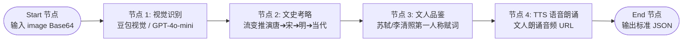

# 🛠️ 明日 Coze 工作流搭建保姆级操作手册 (10-14 下午专用)

> **责任人**：队长 · 郑小君  
> **目标**：在 Coze 平台 30 分钟内极速搭建并发布 `sino_wind_artifact_recognition` 工作流，18:00 前导出 Token 交付刘霞。

---

## 📌 整体工作流设计蓝图



---

## 📝 详细节点配置（直接复制到 Coze）

### 1. 【Start 输入节点】
- **变量名**：`image`
- **类型**：`String`
- **描述**：前端 Canvas 压缩后的 JPEG Base64 图片数据（约 200KB~400KB）

---

### 2. 【节点 1：大模型视觉识别（Visual Recognition）】
- **模型选择**：`Doubao-Vision` 或 `GPT-4o-mini`
- **输入**：`{{input.image}}`
- **System Prompt**：
```text
你是一位精通中国古物、文玩古董与现代生活日用品的资深鉴赏家。
请仔细观察用户上传的图片，判断图中物品的日常名称、现代属性和材质。
如果该物品属于现代日常用品（如保温杯、钢笔、陶瓷杯、背包等），请挖掘其在古代可能对应的器物类型。
输出必须简练明确：
- 现代名称：如「现代不锈钢真空保温杯」
- 对应古物原型：如「宋代青白瓷汤瓶 / 执壶」
- 材质特点：如「金属真空双层保温」
```

---

### 3. 【节点 2：古物溯源与流变推演（History Evolution）】
- **输入**：引用节点 1 的识别结果
- **System Prompt**：
```text
请根据上述器物原型，考证其在中国历朝历代的文化演变轨迹。
必须严格输出四阶段流变格式：
【流变考略】唐代[器物] ➔ 宋代[器物] ➔ 明代[器物] ➔ 当代[器物]。
示例：
【流变考略】唐代金银执壶 ➔ 宋代影青汤瓶 ➔ 明代紫砂提梁 ➔ 当代真空器。
```

---

### 4. 【节点 3：名士第一人称品鉴赋词与评分（Literati Appraisal）】
- **输入**：引用节点 1 与节点 2 的考证内容
- **System Prompt**：
```text
请以两宋名士（苏轼、李清照、米芾）的第一人称古雅口吻，对这件器物撰写 80~120 字的品鉴心得。
措辞典雅温厚，兼具生活烟火气与金石风骨。
同时给出 85~98 之间的雅士品位评分（整型数值）。
严格按照以下格式组织段落：
[品鉴长文]
[流变考略]
```

---

### 5. 【节点 4：TTS 语音生成（Text-to-Speech）】
- **插件/节点**：选用 Coze 官方内置 TTS 插件（声音选择：沉稳文人音色 / 磁性青年音色）
- **输入文本**：引用节点 3 生成的文人品鉴心得
- **输出**：音频直链 URL `audio_url`

---

### 6. 【End 输出节点（严格 JSON 格式契约）】
在 End 节点配置响应体为 JSON，映射各节点输出变量：

```json
{
  "name": "{{node3.name}}",
  "dynasty": "宋代",
  "description": "{{node3.description}}",
  "score": {{node3.score}},
  "audio_url": "{{node4.audio_url}}"
}
```

> [!IMPORTANT]
> **字段契约校验**：
> - `name`：String，不超过 100 字符；
> - `dynasty`：String，如 "宋代"；
> - `description`：String，品鉴长文 + 流变考略；
> - `score`：Number，0~100 之间的数字；
> - `audio_url`：String，以 http:// 或 https:// 开头的音频直链。

---

## 🚀 发布与 Token 导出步骤

1. 点击右上角 **「发布」(Publish)**；
2. 发布渠道选择 **API** 或 **Webhook**；
3. 复制生成的 **Webhook URL** 与 **Personal Access Token**；
4. 18:00 前将 Token 发给刘霞，刘霞填入 `backend/.env.local` 即可立刻开始真实联调：
   ```env
   COZE_ENDPOINT=https://your-coze-webhook-url
   COZE_API_TOKEN=pat_xxxxxxxxxxxxxxxx
   COZE_TIMEOUT=20000
   ```
